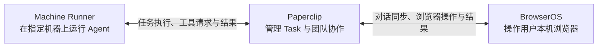

# Paperclip 接入的长期维护

我们的目标是打通 **Paperclip 的任务协作、Machine Runner 的远程执行，以及 BrowserOS 的本机浏览器能力**。

- **Paperclip 管任务**：统一分配、团队协作、执行记录和结果。
- **Runner 跑 Agent**：在指定机器上运行 Codex、Claude 等 CLI，复用该机器的工作区与登录环境，主动连接 Paperclip，无需开放入站端口。
- **BrowserOS 操作浏览器**：远程 Agent 使用用户本机浏览器及已有登录状态，过程和结果同步回两端。

解决任务与执行机器分离、远程 Agent 无法直接操作本机浏览器、多人协作上下文难接续的问题，同时降低长期跟随上游的维护成本。

**扩展 Agent 也是核心目标**：Codex、Claude、Kiro、Hermes、Grok，以及以后引入的其他 Agent，都应纳入 BrowserOS 的接入范围。按实际能力设计适配，不能把现有品牌白名单当作长期产品边界。目标是共用任务、远程执行和浏览器控制链路；各 Agent 的当前支持状态与验证证据单独标注。



Runner 和 BrowserOS 都主动连接 Paperclip；远程 Agent 的浏览器请求经 Paperclip 转发给 BrowserOS，工具结果沿原路返回。

维护上，核心业务语义和持久数据应长期保留，上游接入代码可以替换。

基线：BrowserOS `efa8edeb4`，Paperclip `08e3bda0d`。规范需求、协议和阶段计划以配套 Paperclip 仓库的 `doc/integrations/browseros-contracts.md`、`doc/integrations/browseros-maintenance.md`、`doc/plans/2026-10-18-browseros-machine-maintenance.md` 为准，避免在两仓复制两份完整协议。这里维护 BrowserOS 自身的接入清单。

## 多 Agent 接入边界

长期按能力接入所有 Agent，不在 BrowserOS 固化 Codex/Claude 品牌名单。Paperclip 负责统一能力发现和服务端准入，Runner 负责执行机探测与 provider 适配，BrowserOS 共用绑定、同步和工具执行链路。模型与思考强度按远端声明展示，不支持的选项明确说明。

能参与任务和能实际控制浏览器需要分别验证；缺少 Run 专属工具通道的 Agent 应补齐适配，不能把纯文本输出算作浏览器执行成功。ACP 是当前路径，其他执行方式满足相同任务、工具、暂停、取消与结果契约也可接入。

当前服务端通过统一能力入口注册 Codex、Claude、Kiro、Hermes、Grok 的 ACP 路径；界面使用远端模型/effort 能力，支持手工模型 ID，并显示不可用 Agent 的原因。注册不等于当前机器已登录或已通过真实验收；各 Agent 的结果、外部额度限制和缺口见 Paperclip 的 `tests/browseros-machine-acceptance/implementation-2026-10-18.md`。完整能力契约与覆盖状态维护在 Paperclip 的 `doc/integrations/browseros-contracts.md`（R16–R17）。

## 核心和可替换接入

以下路径相对本包根目录。

| 边界 | 实现入口 | 升级必须保持 |
| --- | --- | --- |
| 核心运行状态 | `apps/server/src/lib/agents/acp/paperclip-agent-runtime.ts` | 每个对话的后台 worker、同步、暂停、恢复；关闭聊天流不关闭后台 |
| 远端协议与本地绑定 | `apps/server/src/lib/agents/acp/paperclip-client.ts`、`paperclip-binding.ts` | requestId 复用、原子保存、OAuth 刷新、连接身份不能静默改变 |
| Agent 类型和配置 | `packages/shared/src/schemas/agent.ts`、server `agent-types.ts`、`storage/acp-agent-store.ts`、`api/routes/agents.ts` | 凭据只在后台，模型/effort 仍可编辑，刷新和删除回调不丢失 |
| ACP 分派 | server `acp-agent-runtime.ts`、`acp-agent-policy.ts`、`api/services/chat-service.ts`、`api/types.ts` | Paperclip 分支不改变普通本地 ACP；运行租约要正确释放 |
| 服务启动 | server `api/routes/index.ts` | 后台恢复、可信来源检查、本机工具租约、Agent 删除和变更通知 |
| 本机工具 | server `api/services/mcp/browser-mcp-module.ts` | 初始化浏览器操作指令、只读和取消、实时工具 schema |
| 本地对话 | server conversation store/schema、`api/routes/conversations.ts` | 同步落库、稳定消息 ID、删除后不复活、不得顺手删除远端 Task |
| UI 映射 | app chat hooks、`paperclip-connection.hooks.ts`、`PaperclipConnectionBar.tsx`、`ChatLayout.tsx`、`NewTabChat.tsx` | 两入口连接状态一致，暂停与 Stop 含义不同，历史消息不回声重发 |
| 配置界面 | app Agent hooks/menu/types、`PaperclipAgentDialog.tsx`、provider dialogs | URL/OAuth/Agent 选择、Task 模型覆盖，不泄露 token |

下一步可以让核心依赖 BindingStore、ConversationSink、AgentConfigProvider、BrowserToolAccess 等窄接口；这些是拟议边界，不是今天已经存在的插件 API。先保留现有运行行为，再逐个移动适配代码，不进行一次性 UI/协议/存储重写。

## 数据和升级约束

绑定 JSON 包含连接 identity、Task ID、待发消息 requestId/正文/设置、启用/删除状态与同步信息。重构时必须兼容旧数据，不能解析失败就创建新 Task。现在由 `paperclip-binding.ts` 独立处理读写与校验，保存显式 `version: 1`。旧格式读取后保留原 Task/requestId 并原子升级；损坏、未来版本或连接身份不一致时拒绝继续，原文件保留。完整 BindingStore/ConversationSink 接口仍是后续重构项。

Paperclip 已通过 0356 迁移将现存旧身份回填到 `browseros_task_bindings`；新 Task 与绑定在同一事务保存，上游 7 天幂等清理不再使绑定失效。迁移前已经丢失的身份无法自动证明来源，不能通过重新建 Task 或按标题认领掩盖问题。升级应停止旧控制端写入，避免混跑只认识旧表的代码。

## 验收入口

配套 Paperclip 仓库提供：

```sh
node tests/browseros-machine-acceptance/run.mjs --check /absolute/private/config.json
node tests/browseros-machine-acceptance/run.mjs --run /absolute/private/config.json /absolute/private/evidence
```

配置中的 BrowserOS Agent 必须指向同一独立 Paperclip 测试实例和 Machine 上的被测 Agent；不要把真实日常账号/生产实例当测试夹具。每次运行新建 conversation/Task，并使用独立报告目录，不依赖旧 Task ID。测试结束暂停本次连接并保留证据和测试页，便于审查；不修改全局 Agent 设置，不停止共享服务。

自动 live 覆盖建 Task、团队继续、真实 ACP 浏览器工具、暂停恢复、本地继续、Stop、普通 Task 隔离和双端结果。UI 模型选择、服务重启、断网副作用和数据库迁移另有验收责任，不能由这个 live 成功替代。

BrowserOS 现有回归入口包括：

- `apps/server/tests/lib/agents/acp/paperclip-binding.test.ts`
- `apps/server/tests/lib/agents/acp/paperclip-agent-runtime.test.ts`
- `apps/server/tests/lib/agents/acp/acp-agent-runtime.test.ts`
- `apps/server/tests/api/services/mcp/browser-mcp-module.test.ts`
- `apps/server/tests/api/routes/agents.test.ts`

更新上游前记录两仓 commit、Runner 和 provider bridge 版本。更新后先检查上述接入边界，再跑相关回归与 live；保留首次失败，不能仅保存最后一次成功。只有当实际开始 UI 重构时才调整渲染层测试，外部行为标准保持不变。
