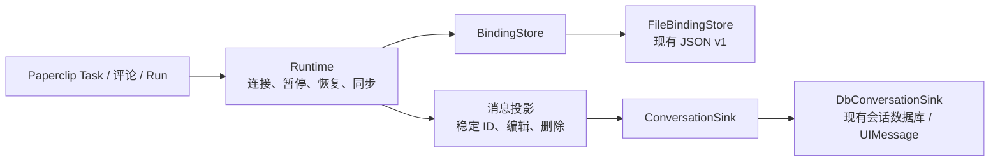
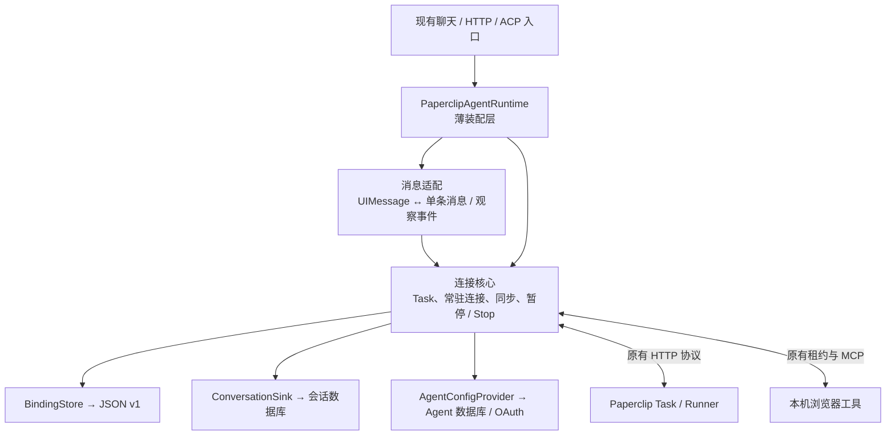

# Paperclip 接入的长期维护

我们的目标是打通 **Paperclip 的任务协作、Machine Runner 的远程执行，以及 BrowserOS 的本机浏览器能力**。

- **Paperclip 管任务**：统一分配、团队协作、执行记录和结果。
- **Runner 跑 Agent**：在指定机器上运行 Codex、Claude 等 CLI，复用该机器的工作区与登录环境，主动连接 Paperclip，无需开放入站端口。
- **BrowserOS 操作浏览器**：远程 Agent 使用用户本机浏览器及已有登录状态，过程和结果同步回两端。

解决任务与执行机器分离、远程 Agent 无法直接操作本机浏览器、多人协作上下文难接续的问题，同时降低长期跟随上游的维护成本。

**扩展 Agent 也是核心目标**：Codex、Claude、Kiro、Hermes、Grok，以及以后引入的其他 Agent，都应纳入 BrowserOS 的接入范围。按实际能力设计适配，不能把现有品牌白名单当作长期产品边界。目标是共用任务、远程执行和浏览器控制链路；各 Agent 的当前支持状态与验证证据单独标注。


Runner 和 BrowserOS 都主动连接 Paperclip；远程 Agent 的浏览器请求经 Paperclip 转发给 BrowserOS，工具结果沿原路返回。

维护上，核心业务语义和持久数据应长期保留，上游接入代码可以替换。

基线：BrowserOS `efa8edeb4`，Paperclip `08e3bda0d`。规范需求、协议和阶段计划以配套 Paperclip 仓库的 `doc/integrations/browseros-contracts.md`、`doc/integrations/browseros-maintenance.md`、`doc/plans/2026-10-18-browseros-machine-maintenance.md` 为准，避免在两仓复制两份完整协议。这里维护 BrowserOS 自身的接入清单。

## 多 Agent 接入边界

长期按能力接入所有 Agent，不在 BrowserOS 固化 Codex/Claude 品牌名单。Paperclip 负责统一能力发现和服务端准入，Runner 负责执行机探测与 provider 适配，BrowserOS 共用绑定、同步和工具执行链路。模型与思考强度按远端声明展示，不支持的选项明确说明。

能参与任务和能实际控制浏览器需要分别验证；缺少 Run 专属工具通道的 Agent 应补齐适配，不能把纯文本输出算作浏览器执行成功。ACP 是当前路径，其他执行方式满足相同任务、工具、暂停、取消与结果契约也可接入。

当前服务端通过统一能力入口注册 Codex、Claude、Kiro、Hermes、Grok 的 ACP 路径；界面使用远端模型/effort 能力，支持手工模型 ID，并显示不可用 Agent 的原因。注册不等于当前机器已登录或已通过真实验收；各 Agent 的结果、外部额度限制和缺口见 Paperclip 的 `tests/browseros-machine-acceptance/implementation-2026-10-18.md`。完整能力契约与覆盖状态维护在 Paperclip 的 `doc/integrations/browseros-contracts.md`（R16–R17）。

## 核心和可替换接入

以下路径相对本包根目录。

| 边界 | 实现入口 | 升级必须保持 |
| --- | --- | --- |
| 核心运行状态 | `apps/server/src/lib/agents/acp/paperclip-connection-runtime.ts`；`paperclip-agent-runtime.ts` 保留装配入口 | 每个对话的后台 worker、同步、暂停、恢复；关闭聊天流不关闭后台 |
| 远端协议与本地绑定 | `apps/server/src/lib/agents/acp/paperclip-client.ts`、`paperclip-binding.ts` | requestId 复用、原子保存、OAuth 刷新、连接身份不能静默改变 |
| Agent 类型和配置 | `packages/shared/src/schemas/agent.ts`、server `agent-types.ts`、`storage/acp-agent-store.ts`、`api/routes/agents.ts` | 凭据只在后台，模型/effort 仍可编辑，刷新和删除回调不丢失 |
| ACP 分派 | server `acp-agent-runtime.ts`、`acp-agent-policy.ts`、`api/services/chat-service.ts`、`api/types.ts` | Paperclip 分支不改变普通本地 ACP；运行租约要正确释放 |
| 服务启动 | server `api/routes/index.ts` | 后台恢复、可信来源检查、本机工具租约、Agent 删除和变更通知 |
| 本机工具 | server `api/services/mcp/browser-mcp-module.ts` | 初始化浏览器操作指令、只读和取消、实时工具 schema |
| 本地对话 | server conversation store/schema、`api/routes/conversations.ts` | 同步落库、稳定消息 ID、删除后不复活、不得顺手删除远端 Task |
| UI 映射 | app chat hooks、`paperclip-connection.hooks.ts`、`PaperclipConnectionBar.tsx`、`ChatLayout.tsx`、`NewTabChat.tsx` | 两入口连接状态一致，暂停与 Stop 含义不同，历史消息不回声重发 |
| 配置界面 | app Agent hooks/menu/types、`PaperclipAgentDialog.tsx`、provider dialogs | URL/OAuth/Agent 选择、Task 模型覆盖，不泄露 token |

已将存储和消息写入收敛为两个窄接口，保持 JSON v1、Task/requestId、消息 ID 和现有 UI 行为：

- `paperclip-binding-store.ts`：`BindingStore` 提供 list/open，`FileBindingStore` 封装现有文件目录、身份校验与原子读写。
- `paperclip-conversation.ts`：`ConversationSink` 接收完整消息快照；纯函数投影处理作者、编辑删除、本机消息 ID 与 Run 输出替换。
- `paperclip-conversation-sink.ts`：`DbConversationSink` 负责 UIMessage/上游 ConversationStore 格式适配。只有落库成功，Runtime 才更新同步确认状态；失败由后续同步补写。



后续阶段已补齐配置存储和前台消息边界：

- `paperclip-runtime-ports.ts`：定义 `AgentConfigProvider`、最小 Agent/单条消息输入和 `start/text/finish` 事件。核心不再接收 `UIMessage[]` 或完整 `AcpAgentDefinition`。
- `paperclip-agent-config.ts`：`DbAgentConfigProvider` 适配上游 AgentStore，封装 OAuth 刷新和凭据保存；默认单例让 HTTP 连接查询与所有后台 worker 共用并发刷新，保存失败继续向上传递。保留静态 token 的原行为。
- `paperclip-connection-runtime.ts`：保留连接、Task/requestId、同步、恢复、暂停/Stop 状态机。存储和配置全部注入，不再创建数据库 store 或 AI SDK stream。
- `paperclip-stream.ts`：从 UI 历史提取最后一条本地 user 消息，转换观察事件为原 AI SDK chunks；附件拒绝、错误文本和 onFinish 的持久历史回传保持不变。
- `paperclip-agent-runtime.ts`：薄装配入口，保留原构造方法、`stream`、生命周期方法与旧 `getAgent` 测试注入口；ACP 分派、路由、UI 和外部故障夹具无需迁移。新调用者可注入完整 `agentConfigs`。



以后上游变更 Agent 数据库、UI 消息或聊天流接口时，优先调整对应适配层；连接核心和原有验收保持稳定。业务源码仅调整自有集成文件，没有增加对 ACP 分派、HTTP 路由、UI 组件的补丁。本轮没有数据迁移、wire 协议变化或新增调度器。

这是仓库内接口，不是稳定公开插件 API。BrowserToolAccess 已按下面的边界提取；消息同步仍为全量分页，仍使用现有 AI SDK 渲染，未改成新的增量消息协议。

## 浏览器工具边界

`paperclip-runtime-ports.ts` 的 `BrowserToolAccess.acquire(scope, runId, signal)` 返回一个只有 `call(request)` 和 `release()` 的本机工具句柄。`paperclip-browser-tool-access.ts` 的 `LocalMcpBrowserToolAccess` 适配现有 BrowserMcpModule 租约工厂与 loopback `/mcp`；本机端口、租约 token/请求头、只读 query、JSON/SSE 解析和 25 秒 HTTP 超时只留在适配器。

`PaperclipAgentRuntime` 默认装配这个适配器，保留原 `createToolLease` 注入口、构造参数和路由接线，也允许注入完整 `browserTools`。内部连接核心构造方法只接收依赖，不再接收 serverPort、导入 BrowserToolLease 或直接调用本机 MCP。上游路由、BrowserMcpModule 和普通 ACP 路径没有改动。


必须保留的调用顺序和接口约定：

1. **先查远端授权**，再创建本机工具租约。远端拒绝时不能取得本机权限。
2. `scope`、remote run ID 和取消 signal 原样进入现有租约工厂，保留只读上限、浏览器上下文和 Run 执行守卫。本机 token 不进入核心状态、存储或 Paperclip 请求。
3. 核心继续每秒检查当次远端 call 是否有效；即使另一个 Run 仍活跃，当次 call 被撤销也必须取消。不能仅依赖 Task snapshot 的“仍有 live run”。
4. 正常调用先回传工具结果，回传成功或失败后都在 finally 中 `release()`，再结束撤销监听。`release()` 应同步撤销本机租约且不抛错；取消执行靠传入的 signal，不把删除 token 当成停止已有调用。
5. 暂停和 shutdown 取消本机调用及连接，等待释放后 detach；Stop 取消当前调用并停止远端 Run，保持连接启用。前台自然结束不关闭后台。
6. 本机 HTTP/解析/取消错误继续转换为原 JSON-RPC `-32000` 错误，保留 request ID；正常 MCP 错误原样回传。SSE 选择匹配 ID 的响应，禁止重定向。适配器不增加自动重试，结果未知时不能重复执行工具。

回归入口新增 `paperclip-browser-tool-access.test.ts`（本机 HTTP/格式/取消）和 `paperclip-tool-lifecycle.test.ts`（授权/回传/释放/暂停/Stop/撤销顺序）；原 BrowserMcpModule 权限和普通 ACP 测试仍执行。故障验收源码清单已加入新适配器，不能只哈希旧 Runtime 门面文件。

## 数据和升级约束

绑定 JSON 包含连接 identity、Task ID、待发消息 requestId/正文/设置、启用/删除状态与同步信息。重构时必须兼容旧数据，不能解析失败就创建新 Task。现在由 `paperclip-binding.ts` 独立处理读写与校验，保存显式 `version: 1`。旧格式读取后保留原 Task/requestId 并原子升级；损坏、未来版本或连接身份不一致时拒绝继续，原文件保留。目录枚举与打开现由 FileBindingStore 适配，Runtime 通过接口使用；没有引入数据迁移或协议版本变更。

Paperclip 已通过 0356 迁移将现存旧身份回填到 `browseros_task_bindings`；新 Task 与绑定在同一事务保存，上游 7 天幂等清理不再使绑定失效。迁移前已经丢失的身份无法自动证明来源，不能通过重新建 Task 或按标题认领掩盖问题。升级应停止旧控制端写入，避免混跑只认识旧表的代码。

## 验收入口

配套 Paperclip 仓库提供：

```sh
node tests/browseros-machine-acceptance/run.mjs --check /absolute/private/config.json
node tests/browseros-machine-acceptance/run.mjs --run /absolute/private/config.json /absolute/private/evidence
```

配置中的 BrowserOS Agent 必须指向同一独立 Paperclip 测试实例和 Machine 上的被测 Agent；不要把真实日常账号/生产实例当测试夹具。每次运行新建 conversation/Task，并使用独立报告目录，不依赖旧 Task ID。测试结束暂停本次连接并保留证据和测试页，便于审查；不修改全局 Agent 设置，不停止共享服务。

自动 live 覆盖建 Task、团队继续、真实 ACP 浏览器工具、暂停恢复、本地继续、Stop、普通 Task 隔离和双端结果。UI 模型选择和数据库迁移另有验收责任，不能由这个 live 成功替代。断网、poll/result/ack 丢失、后台与工具转发进程 SIGKILL、暂停后重启已有 `tests/browseros-machine-acceptance/faults/run.mjs` 独立夹具，可指定 `--cdp` 在专用页面计数。完整 Paperclip 服务、PostgreSQL 及两者同时硬重启，Runner CLI 被 SIGKILL 后的进程回收现已通过独立实例验收，见 Paperclip `tests/browseros-machine-acceptance/hard-restart-validation-2026-10-18.md`。整个浏览器应用硬重启仍未覆盖。具体命令、首次失败和最终证据见 Paperclip `tests/browseros-machine-acceptance/faults/README.md` 与同目录验证记录。

BrowserOS 现有回归入口包括：

- `apps/server/tests/lib/agents/acp/paperclip-binding.test.ts`
- `apps/server/tests/lib/agents/acp/paperclip-conversation.test.ts`
- `apps/server/tests/lib/agents/acp/paperclip-agent-runtime.test.ts`（含直接注入配置/存储的核心测试）
- `apps/server/tests/lib/agents/acp/paperclip-agent-config.test.ts`（并发刷新、持久化失败、静态凭据）
- `apps/server/tests/lib/agents/acp/paperclip-stream.test.ts`（消息输入、流 ID、onFinish 和错误）
- `apps/server/tests/lib/agents/acp/acp-agent-runtime.test.ts`
- `apps/server/tests/api/services/mcp/browser-mcp-module.test.ts`
- `apps/server/tests/api/routes/agents.test.ts`

更新上游前记录两仓 commit、Runner 和 provider bridge 版本。更新后先检查上述接入边界，再跑相关回归与 live；保留首次失败，不能仅保存最后一次成功。只有当实际开始 UI 重构时才调整渲染层测试，外部行为标准保持不变。

## 应用工作区构建与类型检查

在 `packages/browseros-agent` 中执行。除 Bun 外，Rust 工作区还需要 Cargo 和本机链接器；最低 Rust 版本以根 `Cargo.toml` 的 `rust-version` 为准。

```sh
bun run typecheck
cargo check --workspace --locked
cargo build --workspace --locked
bun run build:server:ci
bun run build:agent
bun run --filter @browseros/claw-app build
bun run build:app-onboard
bun run build:claw-onboard
```

`build:server:ci` 只生成本地产物，不上传 R2，也不要求生产密钥。扩展构建前不要配置 `SENTRY_AUTH_TOKEN`，以免启用 sourcemap 上传。其余默认发布脚本可能上传资源，不能当成本地验收的等价命令。

这组检查覆盖应用工作区的 TypeScript、Rust、本机原生程序、服务端打包、扩展及引导页；不代表 Chromium 浏览器内核源码构建、跨平台运行或真实 Agent 端到端验收。2026-10-18 的两仓执行结果及环境版本统一记录在 Paperclip `tests/browseros-machine-acceptance/workspace-validation-2026-10-18.md`。

Paperclip 的 14 个 BrowserOS HTTP 操作现已纳入 OpenAPI 覆盖检查。后续改动请求体时维护 `server/src/services/browseros/http-contract.ts`，实际 handler 与 `server/src/routes/browseros-openapi.ts` 共用该契约；规范必须区分个人 OAuth、Run 浏览器能力令牌和仅返回 405 的 MCP GET/DELETE，不能用普通 Agent API key 的描述替代。

本次配置存储与消息接口拆分的实际验收、首次失败和覆盖边界见配套 Paperclip 仓库 `tests/browseros-machine-acceptance/interface-refactor-validation-2026-10-18.md`。

BrowserToolAccess 拆分后的当轮验证与首次失败记录见 Paperclip `tests/browseros-machine-acceptance/browser-tool-access-validation-2026-10-18.md`。
