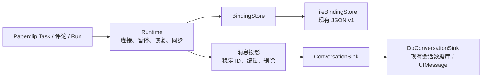
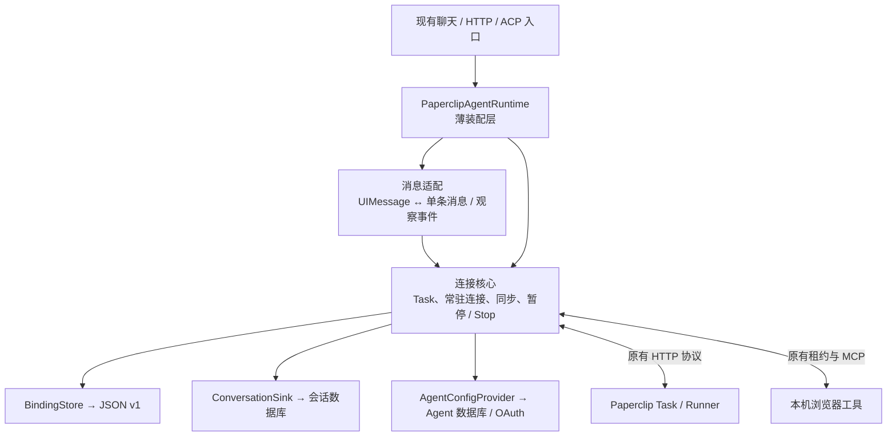
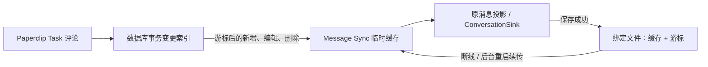
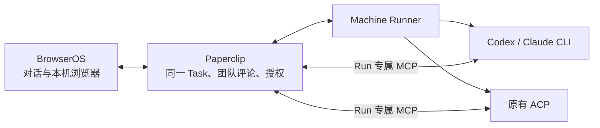

# Paperclip 接入的长期维护

我们的目标是打通 **Paperclip 的任务协作、Machine Runner 的远程执行，以及 BrowserOS 的本机浏览器能力**。

- **Paperclip 管任务**：统一分配、团队协作、执行记录和结果。
- **Runner 跑 Agent**：在指定机器上运行 Codex、Claude 等 CLI，复用该机器的工作区与登录环境，主动连接 Paperclip，无需开放入站端口。
- **BrowserOS 操作浏览器**：远程 Agent 使用用户本机浏览器及已有登录状态，过程和结果同步回两端。

解决任务与执行机器分离、远程 Agent 无法直接操作本机浏览器、多人协作上下文难接续的问题，同时降低长期跟随上游的维护成本。

**扩展 Agent 也是核心目标**：Codex、Claude、Kiro、Hermes、Grok，以及以后引入的其他 Agent，都应纳入 BrowserOS 的接入范围。按实际能力设计适配，不能把现有品牌白名单当作长期产品边界。目标是共用任务、远程执行和浏览器控制链路；各 Agent 的当前支持状态与验证证据单独标注。


Runner 和 BrowserOS 都主动连接 Paperclip；远程 Agent 的浏览器请求经 Paperclip 转发给 BrowserOS，工具结果沿原路返回。

维护上，核心业务语义和持久数据应长期保留，上游接入代码可以替换。

基线：BrowserOS `efa8edeb4`，Paperclip `08e3bda0d`。规范需求、协议和阶段计划以配套 Paperclip 仓库的 `doc/integrations/browseros-contracts.md`、`doc/integrations/browseros-maintenance.md`、`doc/plans/2026-10-18-browseros-machine-maintenance.md` 为准，避免在两仓复制两份完整协议。这里维护 BrowserOS 自身的接入清单。

## 多 Agent 接入边界

长期按能力接入所有 Agent，不在 BrowserOS 固化 Codex/Claude 品牌名单。Paperclip 负责统一能力发现和服务端准入，Runner 负责执行机探测与 provider 适配，BrowserOS 共用绑定、同步和工具执行链路。模型与思考强度按远端声明展示，不支持的选项明确说明。

能参与任务和能实际控制浏览器需要分别验证；缺少 Run 专属工具通道的 Agent 应补齐适配，不能把纯文本输出算作浏览器执行成功。当前支持 ACP、Codex/Claude 原生 CLI，以及配套 Paperclip 的 native Codex/Claude Runner；其他执行方式满足相同任务、工具、暂停、取消与结果契约也可接入。

当前服务端通过统一能力入口注册 Codex/Claude 的 CLI/ACP 双路径、Kiro、Hermes、Grok 的 ACP 路径，以及 `paperclip_runner` 的 Codex、Claude/ACPX profile；界面使用远端模型/effort 能力，支持手工模型 ID，并显示不可用 Agent 的原因。注册不等于当前机器已登录或已通过真实验收；各 Agent 的结果、外部额度限制和缺口见 Paperclip 的 `tests/browseros-machine-acceptance/implementation-2026-10-18.md`。完整能力契约与覆盖状态维护在 Paperclip 的 `doc/integrations/browseros-contracts.md`（R16–R17）。

## 核心和可替换接入

以下路径相对本包根目录。

| 边界 | 实现入口 | 升级必须保持 |
| --- | --- | --- |
| 核心运行状态 | `apps/server/src/lib/agents/acp/paperclip-connection-runtime.ts`；`paperclip-agent-runtime.ts` 保留装配入口 | 每个对话的后台 worker、同步、暂停、恢复；关闭聊天流不关闭后台 |
| 远端协议与本地绑定 | `apps/server/src/lib/agents/acp/paperclip-client.ts`、`paperclip-binding.ts` | requestId 复用、原子保存、OAuth 刷新、连接身份不能静默改变 |
| Agent 类型和配置 | `packages/shared/src/schemas/agent.ts`、server `agent-types.ts`、`storage/acp-agent-store.ts`、`api/routes/agents.ts` | 凭据只在后台，模型/effort 仍可编辑，刷新和删除回调不丢失 |
| ACP 分派 | server `acp-agent-runtime.ts`、`acp-agent-policy.ts`、`api/services/chat-service.ts`、`api/types.ts` | Paperclip 分支不改变普通本地 ACP；运行租约要正确释放 |
| 服务启动 | server `api/routes/index.ts` | 后台恢复、可信来源检查、本机工具租约、Agent 删除和变更通知 |
| 本机工具 | server `api/services/mcp/browser-mcp-module.ts` | 初始化浏览器操作指令、只读和取消、实时工具 schema |
| 本地对话 | server conversation store/schema、`api/routes/conversations.ts` | 同步落库、稳定消息 ID、删除后不复活、不得顺手删除远端 Task |
| UI 映射 | app chat hooks、`paperclip-connection.hooks.ts`、`PaperclipConnectionBar.tsx`、`ChatLayout.tsx`、`NewTabChat.tsx` | 两入口连接状态一致，暂停与 Stop 含义不同，历史消息不回声重发 |
| 配置界面 | app Agent hooks/menu/types、`PaperclipAgentDialog.tsx`、provider dialogs | URL/OAuth/Agent 选择、Task 模型覆盖，不泄露 token |

已将存储和消息写入收敛为两个窄接口，保持 JSON v1、Task/requestId、消息 ID 和现有 UI 行为：

- `paperclip-binding-store.ts`：`BindingStore` 提供 list/open，`FileBindingStore` 封装现有文件目录、身份校验与原子读写。
- `paperclip-conversation.ts`：`ConversationSink` 接收完整消息快照；纯函数投影处理作者、编辑删除、本机消息 ID 与 Run 输出替换。
- `paperclip-conversation-sink.ts`：`DbConversationSink` 负责 UIMessage/上游 ConversationStore 格式适配。只有落库成功，Runtime 才更新同步确认状态；失败由后续同步补写。



后续阶段已补齐配置存储和前台消息边界：

- `paperclip-runtime-ports.ts`：定义 `AgentConfigProvider`、最小 Agent/单条消息输入和 `start/text/finish` 事件。核心不再接收 `UIMessage[]` 或完整 `AcpAgentDefinition`。
- `paperclip-agent-config.ts`：`DbAgentConfigProvider` 适配上游 AgentStore，封装 OAuth 刷新和凭据保存；默认单例让 HTTP 连接查询与所有后台 worker 共用并发刷新，保存失败继续向上传递。保留静态 token 的原行为。
- `paperclip-connection-runtime.ts`：保留连接、Task/requestId、同步、恢复、暂停/Stop 状态机。存储和配置全部注入，不再创建数据库 store 或 AI SDK stream。
- `paperclip-stream.ts`：从 UI 历史提取最后一条本地 user 消息，转换观察事件为原 AI SDK chunks；附件拒绝、错误文本和 onFinish 的持久历史回传保持不变。
- `paperclip-agent-runtime.ts`：薄装配入口，保留原构造方法、`stream`、生命周期方法与旧 `getAgent` 测试注入口；ACP 分派、路由、UI 和外部故障夹具无需迁移。新调用者可注入完整 `agentConfigs`。



以后上游变更 Agent 数据库、UI 消息或聊天流接口时，优先调整对应适配层；连接核心和原有验收保持稳定。业务源码仅调整自有集成文件，没有增加对 ACP 分派、HTTP 路由、UI 组件的补丁。本轮没有数据迁移、wire 协议变化或新增调度器。

这是仓库内接口，不是稳定公开插件 API。BrowserToolAccess 已按下面的边界提取；消息同步现由 `paperclip-message-sync.ts` 负责增量分页和本地缓存，仍使用现有 AI SDK 渲染。旧服务未声明能力时沿用全量协议。

## 浏览器工具边界

`paperclip-runtime-ports.ts` 的 `BrowserToolAccess.acquire(scope, runId, signal)` 返回一个只有 `call(request)` 和 `release()` 的本机工具句柄。`paperclip-browser-tool-access.ts` 的 `LocalMcpBrowserToolAccess` 适配现有 BrowserMcpModule 租约工厂与 loopback `/mcp`；本机端口、租约 token/请求头、只读 query、JSON/SSE 解析和 25 秒 HTTP 超时只留在适配器。

`PaperclipAgentRuntime` 默认装配这个适配器，保留原 `createToolLease` 注入口、构造参数和路由接线，也允许注入完整 `browserTools`。内部连接核心构造方法只接收依赖，不再接收 serverPort、导入 BrowserToolLease 或直接调用本机 MCP。上游路由、BrowserMcpModule 和普通 ACP 路径没有改动。


必须保留的调用顺序和接口约定：

1. **先查远端授权**，再创建本机工具租约。远端拒绝时不能取得本机权限。
2. `scope`、remote run ID 和取消 signal 原样进入现有租约工厂，保留只读上限、浏览器上下文和 Run 执行守卫。本机 token 不进入核心状态、存储或 Paperclip 请求。
3. 核心继续每秒检查当次远端 call 是否有效；即使另一个 Run 仍活跃，当次 call 被撤销也必须取消。不能仅依赖 Task snapshot 的“仍有 live run”。
4. 正常调用先回传工具结果，回传成功或失败后都在 finally 中 `release()`，再结束撤销监听。`release()` 应同步撤销本机租约且不抛错；取消执行靠传入的 signal，不把删除 token 当成停止已有调用。
5. 暂停和 shutdown 取消本机调用及连接，等待释放后 detach；Stop 取消当前调用并停止远端 Run，保持连接启用。前台自然结束不关闭后台。
6. 本机 HTTP/解析/取消错误继续转换为原 JSON-RPC `-32000` 错误，保留 request ID；正常 MCP 错误原样回传。SSE 选择匹配 ID 的响应，禁止重定向。适配器不增加自动重试，结果未知时不能重复执行工具。

回归入口新增 `paperclip-browser-tool-access.test.ts`（本机 HTTP/格式/取消）和 `paperclip-tool-lifecycle.test.ts`（授权/回传/释放/暂停/Stop/撤销顺序）；原 BrowserMcpModule 权限和普通 ACP 测试仍执行。故障验收源码清单已加入新适配器，不能只哈希旧 Runtime 门面文件。

## 数据和升级约束

绑定 JSON 包含连接 identity、Task ID、待发消息 requestId/正文/设置、启用/删除状态与同步信息。重构时必须兼容旧数据，不能解析失败就创建新 Task。现在由 `paperclip-binding.ts` 独立处理读写与校验，保存显式 `version: 1`。旧格式读取后保留原 Task/requestId 并原子升级；损坏、未来版本或连接身份不一致时拒绝继续，原文件保留。目录枚举与打开现由 FileBindingStore 适配，Runtime 通过接口使用；没有引入数据迁移或协议版本变更。

Paperclip 已通过 0356 迁移将现存旧身份回填到 `browseros_task_bindings`；新 Task 与绑定在同一事务保存，上游 7 天幂等清理不再使绑定失效。迁移前已经丢失的身份无法自动证明来源，不能通过重新建 Task 或按标题认领掩盖问题。升级应停止旧控制端写入，避免混跑只认识旧表的代码。

## 验收入口

配套 Paperclip 仓库提供：

```sh
node tests/browseros-machine-acceptance/run.mjs --check /absolute/private/config.json
node tests/browseros-machine-acceptance/run.mjs --run /absolute/private/config.json /absolute/private/evidence
```

配置中的 BrowserOS Agent 必须指向同一独立 Paperclip 测试实例和 Machine 上的被测 Agent；不要把真实日常账号/生产实例当测试夹具。每次运行新建 conversation/Task，并使用独立报告目录，不依赖旧 Task ID。测试结束暂停本次连接并保留证据和测试页，便于审查；不修改全局 Agent 设置，不停止共享服务。

自动 live 覆盖建 Task、团队继续、真实 CLI/ACP 浏览器工具、暂停恢复、本地继续、Stop、普通 Task 隔离和双端结果。UI 模型选择和数据库迁移另有验收责任，不能由这个 live 成功替代。断网、poll/result/ack 丢失、后台与工具转发进程 SIGKILL、暂停后重启已有 `tests/browseros-machine-acceptance/faults/run.mjs` 独立夹具，可指定 `--cdp` 在专用页面计数。完整 Paperclip 服务、PostgreSQL 及两者同时硬重启，Runner CLI 被 SIGKILL 后的进程回收现已通过独立实例验收，见 Paperclip `tests/browseros-machine-acceptance/hard-restart-validation-2026-10-18.md`。整个浏览器应用硬重启仍未覆盖。具体命令、首次失败和最终证据见 Paperclip `tests/browseros-machine-acceptance/faults/README.md` 与同目录验证记录。

BrowserOS 现有回归入口包括：

- `apps/server/tests/lib/agents/acp/paperclip-binding.test.ts`
- `apps/server/tests/lib/agents/acp/paperclip-conversation.test.ts`
- `apps/server/tests/lib/agents/acp/paperclip-agent-runtime.test.ts`（含直接注入配置/存储的核心测试）
- `apps/server/tests/lib/agents/acp/paperclip-agent-config.test.ts`（并发刷新、持久化失败、静态凭据）
- `apps/server/tests/lib/agents/acp/paperclip-stream.test.ts`（消息输入、流 ID、onFinish 和错误）
- `apps/server/tests/lib/agents/acp/acp-agent-runtime.test.ts`
- `apps/server/tests/api/services/mcp/browser-mcp-module.test.ts`
- `apps/server/tests/api/routes/agents.test.ts`

更新上游前记录两仓 commit、Runner 和 provider bridge 版本。更新后先检查上述接入边界，再跑相关回归与 live；保留首次失败，不能仅保存最后一次成功。只有当实际开始 UI 重构时才调整渲染层测试，外部行为标准保持不变。

## 应用工作区构建与类型检查

在 `packages/browseros-agent` 中执行。除 Bun 外，Rust 工作区还需要 Cargo 和本机链接器；最低 Rust 版本以根 `Cargo.toml` 的 `rust-version` 为准。

```sh
bun run typecheck
cargo check --workspace --locked
cargo build --workspace --locked
bun run build:server:ci
bun run build:agent
bun run --filter @browseros/claw-app build
bun run build:app-onboard
bun run build:claw-onboard
```

`build:server:ci` 只生成本地产物，不上传 R2，也不要求生产密钥。扩展构建前不要配置 `SENTRY_AUTH_TOKEN`，以免启用 sourcemap 上传。其余默认发布脚本可能上传资源，不能当成本地验收的等价命令。

这组检查覆盖应用工作区的 TypeScript、Rust、本机原生程序、服务端打包、扩展及引导页；不代表 Chromium 浏览器内核源码构建、跨平台运行或真实 Agent 端到端验收。2026-10-18 的两仓执行结果及环境版本统一记录在 Paperclip `tests/browseros-machine-acceptance/workspace-validation-2026-10-18.md`。

Paperclip 的 15 个 BrowserOS HTTP 操作现已纳入 OpenAPI 覆盖检查。后续改动请求体时维护 `server/src/services/browseros/http-contract.ts`，实际 handler 与 `server/src/routes/browseros-openapi.ts` 共用该契约；规范必须区分个人 OAuth、Run 浏览器能力令牌和仅返回 405 的 MCP GET/DELETE，不能用普通 Agent API key 的描述替代。

本次配置存储与消息接口拆分的实际验收、首次失败和覆盖边界见配套 Paperclip 仓库 `tests/browseros-machine-acceptance/interface-refactor-validation-2026-10-18.md`。

BrowserToolAccess 拆分后的当轮验证与首次失败记录见 Paperclip `tests/browseros-machine-acceptance/browser-tool-access-validation-2026-10-18.md`。

## Paperclip 侧工具准备接入点

配套 Paperclip 已把 heartbeat 的浏览器 Run 授权、MCP 配置和绑定 Task 提示词准备集中到 `server/src/services/heartbeat/browser-tool-preparation.ts`。原最终调度检查、网关清理、Stop 和恢复保持各自所有权；BrowserOS 协议与 BrowserToolAccess 无变化。当前验证与覆盖边界见 Paperclip `tests/browseros-machine-acceptance/heartbeat-browser-tools-validation-2026-10-18.md`。

## Paperclip 侧 Machine 工作区策略

配套 Paperclip 已新增 `server/src/services/heartbeat/machine-workspace-policy.ts`：集中 Machine 使用限制、远端源、空控制端配置和工作区描述。Runner 仍负责远端目录校验；heartbeat 原流程负责 Task 绑定、租约获取、远程分派、Stop 与恢复。BrowserOS 的连接、消息同步、BrowserToolAccess 和网络协议保持不变。当前验证见 Paperclip `tests/browseros-machine-acceptance/machine-workspace-policy-validation-2026-10-18.md`。


## Paperclip 侧 Machine 分派接口

配套 Paperclip 的 `server/src/services/heartbeat/adapter-dispatch.ts` 现在统一选择 Machine 或本地执行。它使用当前 Run 已准备的环境与租约，在原最终授权检查内创建执行接口；Machine 错误直接交回原生命周期，不回退到本机执行。Runner 负责远端 Agent，Paperclip 继续负责调度、Stop、租约与恢复，BrowserOS 继续通过常驻连接回传浏览器工具结果。

本轮调整 Paperclip 内部分派接入，并补齐数据库故障掩盖 Machine 断线时的未知结果保护；BrowserOS 的绑定、团队消息、暂停/Stop、BrowserToolAccess 和协议没有改动。真实 Codex、故障与硬重启的当轮结果见 Paperclip `tests/browseros-machine-acceptance/machine-dispatch-validation-2026-10-19.md`。

已分派的绑定 Machine Task 若以通用 `adapter_failed` 结束且没有启动前失败证据，Paperclip 不自动重试浏览器动作；连接恢复、旧执行确认停止后，用户在任一端发新消息继续。普通任务和明确限流仍沿原重试策略。

## 增量消息同步（2026-10-19）

`paperclip-message-sync.ts` 是评论传输边界：通过 snapshot 的 `messageSyncVersion: 1` 协商，调用 `/message-changes?cursor=...` 并处理 reset、评论 upsert 和删除标记。请求每页最多 100 项，保存前按数据库完整微秒精度排好创建顺序，稳定 ID 和原 `projectPaperclipMessages` 继续负责本地回声、团队作者与最终结果替换。



连接核心在对话落库后，把缓存、游标、Run 日志偏移和 transcript 串行写入绑定文件，成功后才更新内存确认状态。发送回执和暂停/恢复共用这条写队列，避免状态互相覆盖。网络、响应丢失、对话或绑定保存失败均保留旧游标重读，不新建 Task，不重发浏览器操作。暂停期间同步继续；空闲增量不返回评论正文，也不重复写本地绑定。

绑定主版本仍为 v1，新增可选 `messageSync: {version: 1, cursor, comments}`。旧绑定直接首次建缓存；派生缓存损坏或版本不支持时丢弃缓存并重读，Task/requestId/启用状态保留；主绑定损坏或未来主版本仍拒绝读取。旧 Paperclip 未声明能力时走 `/messages`，新服务保持旧客户端可用。增量请求的权限、网络和解析错误不触发静默降级。

Paperclip 的 0357 迁移为已有绑定回填评论变更索引，不需要 BrowserOS 手动迁移。秘密脱敏、历史结果投影变化触发重建；另外每五分钟保守全量校准，覆盖外部日志/用户资料变化。当前仍每两秒观察执行状态，ACP 日志输出逻辑保留；不是推送协议，也不承诺彻底消除全量读取。超出 1000 页的单轮同步显式报错，不丢页或推进游标。

验收补充 `paperclip-message-sync.test.ts` 与增量 runtime 用例：旧服务兼容、排序/删除、重读、缓存版本、本地写失败、并发 Resume、暂停与后台恢复。完整服务入口在 Paperclip `tests/browseros-machine-acceptance/faults/full-stack.ts --scenario messages`；实际结果统一见该仓库本轮验收记录。后续跟随上游主要检查 Comment DTO、ConversationSink 和绑定原子保存行为。

本轮最终通过 2,163 项 BrowserOS 测试及工作区检查/构建；两仓完整测试、205 条历史增量实测、真实 Codex、故障与硬重启证据见 Paperclip `tests/browseros-machine-acceptance/incremental-sync-validation-2026-10-19.md`。该记录保留条件跳过、首次失败与覆盖范围。

## Codex / Claude 原生 CLI（2026-10-19）

在 Paperclip 给 Codex 或 Claude Agent 选择 CLI 后，BrowserOS 直接使用该执行方式；显式 ACP 继续走 ACP。无需在 BrowserOS 新增一份 engine 选择，也不需要本机安装这些远程 CLI。保留 Agent 原有默认：未设置 engine 的 Machine 为 CLI，本地 adapter 为 ACP。Machine 需要声明 `browseros-cli-v1` 的新版 Runner（`2026.1019.0-machine.9` 起）；旧版本会在执行前明确要求升级。



Paperclip 在每轮注入绑定 Task 的浏览器、团队协作、暂停和结果回写指令，并将 CLI 文本事件转换成现有 snapshot 的 offset/text。BrowserOS 的 Runtime、增量消息同步、BindingStore、ConversationSink 和 BrowserToolAccess 无需增加 provider 分支。Task 模型/effort 覆盖继续生效；切换 CLI/ACP 仅重建不兼容的 provider 会话，同一 Task 和评论保留。

Codex 使用每 Run 的工具别名和进程凭据，避免写入共享配置；Claude 每 Run 使用独立严格 MCP 配置，暂停时为空配置。两者沿用现有租约撤销、Stop 取消和未知结果保护。协议完整说明在 Paperclip `doc/integrations/browseros-contracts.md`；可重复验收的私有配置增加 `engine: "cli"`，使用同一七阶段 live 脚本。故障夹具支持两个 CLI 的 server/database/both 硬重启，确定性夹具与真实模型验收分别报告。

本轮验证与首次失败统一记录在配套 Paperclip 仓库 `tests/browseros-machine-acceptance/native-cli-validation-2026-10-19.md`，包含真实 Codex/Claude CLI、普通 ACP 隔离、独立服务故障和 Runner 强杀验收；不要用确定性夹具结果替代真实模型结果。

## 2026-10-20 上游合并

本轮从远端重新 clone，在独立本地分支合入 BrowserOS 上游 `ca125dcc2` 的五个提交；配套 Paperclip 合入 `96824a71d` 的 107 个提交。BrowserOS 无文本冲突，原有一对话一 Task、常驻连接、双向增量消息、设置与工具租约接入保持不变。

该次合并时 Paperclip 上游默认 Claude native `paperclip_runner` 尚不支持本通道，故继续拒绝；2026-10-21 的独立适配见下节。Codex/Claude legacy CLI 和 ACP 仍按原配置执行。配套数据库冻结自有 0355–0357，上游同号迁移顺延，升级前需停止旧控制端写入。

两仓本轮命令、结果、首次失败与剩余范围统一记录在配套 Paperclip 的 `tests/browseros-machine-acceptance/upstream-merge-validation-2026-10-20.md`。仅集成分支允许推送；默认分支和 Actions 设置不属于此次变更。

## Native Paperclip Runner（2026-10-21）

BrowserOS 继续使用现有 OAuth、一个对话一个 Task、常驻工具连接和增量消息协议。新的适配在 Paperclip 控制端：native Codex/Claude 通过 PRP dynamic tools 调用同一 browser broker，BrowserOS 不启动第二套 provider，不保存远端 CLI 凭据。旧 CLI/ACP、Machine Runner 和本地暂停/恢复逻辑保留。

Native 工具使用固定 `browseros_list_tools`、`browseros_call_tool` 名称，具体浏览器 schema 仍由当前连接提供。每个动作先在 Run 写 pending；未知结果不自动重放。恢复连接不等于恢复动作。新的用户消息须经过 Paperclip 的进程、租约、持久化身份和停止收据验证，才能开始新的 native session。

模型/effort 由 Paperclip 配置的 native provider profile 声明；BrowserOS 仍只写当前 Task override。native 输出仅同步脱敏后的助手 final/commentary；工具正文和 reasoning 不进入对话投影。API/绑定版本无需升级。

当前 native browser dispatch 限定 Paperclip 本地 macOS/Linux 环境（真实验收为 macOS arm64）；native remote/sandbox 会明确返回不支持原因。跨主机执行继续使用原有 Machine CLI/ACP。控制端在浏览器动作前持久化 OS 进程身份，重启后只清理核实的 Runner/provider 及其后续子进程组；全部物理退出后才能释放租约。未知身份保留阻塞状态，不会显示成成功停止。

配套维护点、真实 Codex/Claude 浏览器与故障验收、历史失败和局限见 Paperclip 的 `doc/integrations/browseros-maintenance.md` 及 `tests/browseros-machine-acceptance/native-runner-validation-2026-10-21.md`。native 的跨主机运行、其他 provider profile、整浏览器进程崩溃仍需独立资格验证，不从旧 Machine 证据推断。

## 本机部署与 Codex / Claude 接入手册（2026-10-21）

本次将现有 macOS arm64 实例更新到 BrowserOS 源码 `f6e20b1c5`、Paperclip `b377e5af9`，随后连接 CLI Trio 的 native Codex 与 Claude。已安装 BrowserOS `0.51.0` Chromium 二进制不变，升级范围是 Bun 服务、开发扩展和 Paperclip release。没有把旧 CLI/ACP 改成 native，也没有新增 BrowserOS provider 分支或绕过准入。

Paperclip 的数据库、release、Agent 配置与 Claude provider-root 修复详见配套 [本机部署维护手册](https://github.com/bloomchic-gz/paperclip/blob/codex/browseros-machine-integration-20261018/doc/integrations/browseros-maintenance.md#本机部署与-codex--claude-接入手册2026-10-21)。本轮完整结果、首次失败及未覆盖项见 [本机部署验收](https://github.com/bloomchic-gz/paperclip/blob/codex/browseros-machine-integration-20261018/tests/browseros-machine-acceptance/local-deployment-validation-2026-10-21.md)。下面的端口、目录名是本次实例记录，后续升级先读取实际启动配置。

### 更新现有服务和扩展

1. 记录原 checkout SHA、Bun 路径、服务启动命令、环境文件、数据目录、已安装扩展及实际 Chromium `--user-data-dir`。备份数据、profile、sidecar 和启动配置；私密文件留在受限目录。此次 BrowserOS 数据在 `~/.browseros-dev`，浏览器使用原开发启动器指定的独立 profile，不能假定 profile 就是数据目录。
2. 在独立 checkout 完成验证后，正常停止相关服务，再将实际运行 checkout 快进到目标集成提交。保留 `.env.development`、`config.dev.json` 及 `<profile>/sidecars/browseros-server.json`。不要以新 profile 验收成功代替旧数据升级成功，也不要使用会清空用户数据的 reset/cleanup 命令。
3. 本次用 Bun `1.4.2`，在 `packages/browseros-agent` 执行以下构建。空 Sentry token 用于本地构建不上传 sourcemap；不是远端发布步骤。

   ```sh
   bun install --frozen-lockfile
   SENTRY_AUTH_TOKEN='' bun run build:agent:dev
   ```

4. 开发扩展产物在 `apps/app/dist/chrome-mv3-dev`；服务继续使用 Bun 执行 `apps/server/src/index.ts`，加载原 `.env.development` 和既有 sidecar 配置。保留原浏览器 launch 参数及 profile，加载新扩展；沿用本机已有的禁用 bundled server/extension 设置，避免同时启动两套服务。不要把某台机器的开发 keychain 参数复制为通用升级要求。
5. 本次用 launchd 管理 `com.browseros.local-app`、`com.browseros.local-server`、`com.browseros.local-web`，均 RunAtLoad；后两项 KeepAlive，浏览器本身不设 KeepAlive。记录并备份实际 plist，不把含环境变量的原件提交到 Git。端口为 server 9435、CDP 9705、扩展 9324、静态预览 5175；CDP 仅监听 loopback，不能为远程 Runner 暴露调试端口。
6. 重启后要求 `GET http://127.0.0.1:9435/system/health` 为 ok 且 `cdpConnected: true`，再确认原 provider、conversation、绑定和扩展 UI 可读。静态网页 200 只证明预览页面可访问，不能代替连接、写权限和实际工具验收。

此次旧源码 `3d76663be` 快进到 `f6e20b1c5`，原 `.env.development` 字节未变、`config.dev.json` 保留；原 provider 和 conversation 各 1 条内容未变。Paperclip 保留原实例，经过存量备份还原演练后执行 33 项迁移。旧 `localhost:3102` Paperclip 连接及其历史保留，新连接使用 `http://127.0.0.1:3100`。

### 连接 CLI Trio 的 native Agent

1. Paperclip 服务设置准确的 `PAPERCLIP_PUBLIC_URL`，通过正常实例 API 启用 Public MCP。BrowserOS URL、登录页、OAuth resource 必须同 origin；本次统一 `http://127.0.0.1:3100`。Paperclip 管理 CLI 登录与 BrowserOS OAuth 分开处理。
2. 在 Paperclip 的目标公司新增独立 `paperclip_runner` Agent，保留原 `codex_local` / `claude_local` 的 engine、模型、认证、上下级和 execution environment。两种 native 配置如下；完整 JSON、Secret 引用和环境探针见 Paperclip 手册。

   | 连接 | Paperclip adapterConfig | 本次模型 / effort |
   | --- | --- | --- |
   | CLI Trio · Native Codex | `provider: "codex"` | `gpt-6.1-sol` / `low` |
   | CLI Trio · Native Claude | `provider: "acpx", acpxAgent: "claude"` | `claude-sonnet-4-6` / `low` |

   两者 `runner: "paperclip"`，使用受控本地 workspace。验收 Agent 关闭 heartbeat 定时唤醒。Codex 使用有效登录，本机 CLI 为 `0.163.0`；Claude 使用既有授权 endpoint，token 存成公司 Secret，不能把 CLI 配置中的明文复制到 BrowserOS。这里 ACPX 是 native Runner 内的 Claude bridge，旧 CLI/ACP 执行路径保持独立。
3. 等 Paperclip environment check 和 Agent lifecycle ready 后，在 BrowserOS 的 Paperclip 连接界面输入新 URL，完成 device OAuth。授权页明确选择 **CLI Trio**，确认 `paperclip:read paperclip:write offline_access`，然后选择对应 remote Agent、模型/effort。不要默认使用页面预选公司，也不要用 configure scope 扩大权限。
4. 给 Codex、Claude 分别建立稳定连接身份；不要复用另一个连接的轮换 refresh token，或覆盖旧连接的 URL、remoteAgentId、clientId。旧对话绑定继续属于原连接。创建后核对 UI 标签、公司、连接状态与实际 Task 链接。

可维护的 API 边界是 `POST /agents/paperclip/connect`（注册 client、申请 device code）、`POST /agents/paperclip/token`（兑换）、`POST /agents/paperclip/connection`（用 token 发现可用连接信息）及 `POST /agents`（`type: "paperclip"`，保存 `paperclipConfig`）。授权维护脚本应先私下持久化成功兑换的 token/refresh，再创建 provider，避免后一步失败丢失一次性 grant。不要把 token 放进命令行、文档或版本库。

这些写接口受 trusted-origin 保护。本次安装的开发扩展 ID 为 `bflpfmnmnokmjhmgnolecpppdbdophmk`，其 Origin 为 `chrome-extension://bflpfmnmnokmjhmgnolecpppdbdophmk`。后续必须从实际安装与信任配置核实 ID，不能照抄。初次 helper 用 `http://127.0.0.1:9435` 作 Origin 得到 403，省略 Origin 同样不通过；实际修正使用已信任扩展的授权流程，没有禁用 origin/CSRF 校验或添加通配符。5175 预览页不自动获得扩展权限。

### Claude 启动失败的部署修复

本次 Paperclip 是 pnpm workspace release，Claude 的环境探针把 `server` 当作 provider root，而锁定依赖实际解析到 release 根的 `node_modules/.pnpm`，导致 `acpx_runtime_unavailable`。在核实同一受控 release 的真实布局后，为 **Paperclip 服务** 增加：

```text
PAPERCLIP_ACPX_PROVIDER_PACKAGE_ROOT=<canonical-absolute-release-root>
PAPERCLIP_ACPX_PROVIDER_PACKAGE_MANIFEST=<same-release-root>/server/package.json
```

确认没有 queued/running Run 后正常重启 Paperclip，重跑 `paperclip_runner/test-environment`，必要时执行 Agent lifecycle retry，直到 `acpx_runtime_ready` 与 ready。保持全部既有环境值，下一次换 release 同步更新这两条绝对路径。这不是 BrowserOS 配置，也不是 npm/provider-pack 安装的通用修复；不得放宽依赖完整性、允许越界依赖或仅修改准入来掩盖问题。本次没有源代码修改，完整检查已通过；Paperclip 重启后原 native Codex 连接仍 online、仍绑定原 Task。

### 真实验收结果与复用标准

本次实际 BrowserOS 和模型通过以下验收；主要操作经 API 驱动，UI 复核标签、online、回复、Task 链接和浏览器页面。它不等于完整点击式配置流程验收。

| 阶段 | Native Codex：CLI-48 | Native Claude：CLI-49 |
| --- | --- | --- |
| 初次浏览器操作 | tabs / snapshot / evaluate 成功 | tabs / snapshot / evaluate 成功 |
| 同对话续聊 | 同 Task，实际只读调用通过 | 同 Task，实际只读调用通过 |
| Stop | 实际等待期间取消；5 个所属 PID 全部物理退出 | 修正提示后实际等待期间取消；8 个所属 PID 全部物理退出 |
| 显式恢复 | 原 Task、原页面，工具成功、done / online | 原 Task、原页面，工具成功、done / online |
| 配置保留 | 接入 Claude 后仍 online | 新增前的 9 个 CLI Trio Agent 配置逐字段一致 |

两路分别用带唯一标记的 Example Domain 页面，并通过独立 CDP 清单确认各目标页仅有一份。再次升级时使用专用对话/页面，记录真实 runtime profile、模型/effort、Task/Run ID、completed 浏览器回执及进程退出证据；同 Task 续聊和恢复必须读到既有页。

Stop 验收需明确说明受控取消目的，先确认无副作用的前台 sleep 真正开始，再发 Stop，要求 Run cancelled 且该 Run 所属进程树全部退出。Claude 首次提示没有说明目的，模型拒绝等待，故那次没有测试到 Stop；保留失败记录后，在同一 Task 用明确的 sleep 120 测试通过。停止确认后发显式新用户消息恢复，不能以 Retry、清 session、新 Task 或自动重放未知浏览器动作替代恢复证明。

本次也保留了错误 Origin、一次性 OAuth 兑换后 provider 创建失败、迁移核对脚本主键错误等首次记录。OAuth 重做留下两条 Codex 同范围同意记录，当前仅保存最终有效凭据；未声称旧授权已撤销，清理前须核对具体 grant/client。

共享本机实例仅执行上述授权范围的专用 Task 验收，没有注入全局数据库故障或强杀浏览器。此次未重跑 legacy CLI/ACP、远程 Runner、团队同步、Pause、普通 Task 或其他模型全矩阵，也没有重编译 Chromium。隔离环境的完整 native 故障资格仍以此前 Paperclip `native-runner-validation-2026-10-21.md` 为准；不能把这次 Stop 恢复或旧模拟测试当成新的故障矩阵通过。native remote/sandbox 仍不支持。

## 真实故障矩阵的复用要求（2026-10-21）

本轮补验使用真实 Codex / Claude 与独立 BrowserOS 页面，覆盖本地 native 和 Docker Linux
Machine CLI/ACP。控制端及数据库均为隔离实例，日常 profile、旧连接、Agent 和共享数据库不参与故障注入。
具体逐项结果和首次失败统一保存在 Paperclip 的
[真实故障矩阵记录](https://github.com/bloomchic-gz/paperclip/blob/codex/browseros-machine-integration-20261018/tests/browseros-machine-acceptance/real-fault-matrix-validation-2026-10-21.md)，
复用入口见
[故障脚本说明](https://github.com/bloomchic-gz/paperclip/blob/codex/browseros-machine-integration-20261018/tests/browseros-machine-acceptance/faults/README.md#真实模型的完整矩阵)。

恢复成功须同时满足：同一 Task、已被控制端接受的真实工具结果、恰好一次副作用、Run succeeded、
Task done、旧执行物理退出与租约结算。CLI 正常退出但 Task blocked，或只看到点击计数，均不足以通过。
本轮 `criteriaVersion: 2` 增加了这些判据；此前判据较弱或主动中断的尝试保留为诊断。
未知动作后的自动重放仍直接失败。legacy 若在浏览器执行前触发上游 disposition 修复，还需核对两个持久来源字段、最多两步的 episode、相同原始用户评论 ID，以及此前零浏览器调用/回执；此规则不适用于 native，也不授予未知动作重放权。暂停后重启要保留 paused、禁止工具、继续同步消息，之后显式恢复。

每条并发路径用独立 browser profile/CDP 端口；16 GB 机器最多两条。专用 headless 页面关闭后台
节流，CDP 超时后仍禁止重试未知求值。长时间故障场景正常轮换自己的短期 OAuth 凭据；不更改共享连接。
Docker 验证真实 Machine 协议、远端进程和网络隔离，不等同于物理主机掉电、公网 TLS 或生产网页全流程。
ACP 必须核对底层 runtime 和仓库补丁，不能以宿主 CLI 的版本代替。

配套 Paperclip 修复了 Claude CLI 成功终态后清理残留进程被误记失败的问题：只有成功终态与可信的
物理清理证据同时存在才判成功，失败或外部强杀仍保留失败。BrowserOS 的 CLI/ACP 配置、绑定和工具协议不变。
Machine native 移植仍需独立的远端所有权、停止回执和真实验收，不能由本轮 legacy 结果推断准入。

本轮另外复核并停用了 fork 的 29 个现有 Actions 工作流（`disabled_manually`）。
仓库级 Actions 策略接口对当前账号返回 403，故未声称已核对该总开关；工作流文件和默认
`main` 未改动。以后合入新增工作流须重新检查其状态。

另有 8 项执行 worker / 整容器强杀真实补验，四条 CLI/ACP 路径均保持未知动作不重放，
停止回执缺失时保存但阻止新消息。它们属于安全保持，不是自动恢复；新连接不能代替旧执行
终止证明。Claude CLI worker 强杀后曾观察到残留 provider，由仅属于测试的容器清理结束。

截至 2026-10-22，六条真实路径的基础矩阵全部完成：两条本地 native 各 12 项、四条 Docker Machine CLI/ACP 各 13 项，共 76 项通过，且每条 suite 的启动与清理通过。8 项硬故障安全保持另计；详细首次失败、模型与平台范围以关联报告为准。

## 本机部署复核（2026-10-22）

Paperclip 已部署 `b092bf18871b0d6b893409204f9c1f35439764af`，发布版本
`2026.1022.0-fault-recovery-b092bf188`；先备份、确认无活动 Run、正常停止服务和数据库，
冷备份原实例后切换独立 release，健康接口核对完整提交。原 release 与冷备份保留。
本次未新增迁移；重启后 367 项迁移状态、既有数据数量及 Agent/实例配置哈希均保持。
BrowserOS 本机 checkout 快进至 `2a6dd8566`，仅维护文档变化，运行实现保持 `f6e20b1c5`。

真实共享实例复验继续使用 CLI Trio Claude 的 CLI-49 / Task
`5f7c52b2-b625-4540-a386-162ca8e96e87`，Run
`a7ad8c87-21ed-4c92-b78c-5aa1dd27070e` 以 native 模式成功完成。
模型实际调用 `browseros.tabs`，收到 completed 且无错误的回执，原 Task 仍为 done，绑定不变。
只读前后 10 个浏览器页面的 ID/URL 摘要完全一致，未新建、关闭或导航页面。
原有 571 条评论全部保留，仅在该 Task 新增两条验收评论；其他数据数量和配置哈希不变。
此处是部署后的只读真实通路复核，不把它计作另一轮故障矩阵。

## Machine native 移植实验（2026-10-22）

Paperclip 已增加测试专用驱动，真实 Machine CLI/worker 启动 Linux `paperclip-runnerd`，
经认证 WSS 使用真实 Codex 和专用 BrowserOS 页面，完成同 provider session 两轮及故障观察。
它不接入生产 heartbeat/数据库/BrowserOS 对话绑定，不能把同 provider session 当作同 Task。
worker 强杀后曾短暂保留 4 个原生相关进程，控制端关闭后才退出；新 Machine 缺少旧执行的
停止回执，因此生产 native Machine 准入仍关闭，原 CLI/ACP 与本地 native 配置不变。
Claude native Machine 也尚未实现或验收，仍需受构建清单授权的 Linux provider 包。

升级时继续使用现有准入规则，不能只把 `paperclip_runner` 加入 Machine 支持列表。
复用代码、实际结果与下一步所需的持久所有权和停止证明，见
[Machine native 实验记录](https://github.com/bloomchic-gz/paperclip/blob/codex/browseros-machine-integration-20261018/tests/browseros-machine-acceptance/machine-native-spike-validation-2026-10-22.md)。


## Machine native 正式接入维护（2026-10-22）

新的控制端路径复用现有 BrowserOS 连接、对话和工具协议；BrowserOS 不负责在远端启动
provider，也不新增一个会话或 Task 来绕过恢复。实际发布状态、逐项结果、首次失败与限制见
[Paperclip 正式接入验收记录](https://github.com/bloomchic-gz/paperclip/blob/codex/browseros-machine-integration-20261018/tests/browseros-machine-acceptance/machine-native-production-validation-2026-10-22.md)。
最终矩阵未完成时继续保持部署门禁；旧实验与旧矩阵不累计为新版通过。

Paperclip 端为 native Codex 或 Claude Agent 显式绑定已升级的 Linux ARM64 glibc Machine，
使用 `preconfigured` home、`per_turn` 生命周期；Runner 独立包为 `2026.1022.0-machine.11`。
执行端保留自己的认证和 cwd，控制端提供匹配的 release daemon/provider pack 与认证 WSS。
原有 CLI/ACP 配置、连接、模型/思考强度与普通 Task 不自动转换。Claude Code 仍自动确定
Claude，Codex 不重复显示 ACP agent；通用 ACP 仍保留原选择。

故障恢复必须检查同一 Task、真实工具结果、回执与租约以及物理进程结束。独立 supervisor
在 worker 强杀后清理已观察进程并补写 outbox；新连接与 PID 消失不能代替精确停止回执。
BrowserOS 绑定 Task 的 Stop 或未完成检查点不会交给新 Run，新消息通过正常准入后保留
Task、重建完整上下文；普通 Task 原有受控 checkpoint 恢复保留。
浏览器未知动作保持 pending，不因重连、续聊或新版工具指纹自动重放。整个容器被强杀且
回执缺失时继续阻止执行；这属于安全保持，不写成自动恢复成功。

复用 [Docker native 构建与完整矩阵](https://github.com/bloomchic-gz/paperclip/blob/codex/browseros-machine-integration-20261018/tests/browseros-machine-acceptance/faults/README.md#docker-中的正式-machine-native-验收)，
Codex/Claude 各测首轮、同 Task、Stop、worker/provider 强杀及全部基础故障；CLI/ACP 和本地
native 分别回归。用独立 profile、数据库、容器和网络，原始凭据/日志只留在私有证据目录。
维护时不强杀日常浏览器、共享数据库或无关 Runner；上线后还要实际调用生产 BrowserOS 工具。

控制端重启后的恢复不只检查一次：Machine 迟到的停止 outbox 到达后，周期恢复须完成
精确回执校验、审计取消和租约结算。缺失回执继续等待，禁止通过清状态或自动重发动作解锁。

远端 native 的 shell 使用执行宿主自己的 HOME/PATH。Paperclip 必须从已绑定的 Machine
通道读取并显式传入 native turn；runnerd 自身继承 PATH 不等于 Codex 工具也获得 PATH。
曾在实际 BrowserOS Stop 验收中发现 `sleep` 不可用，故升级验收要检查真实前台命令已开始，
再检查 Stop、精确回执和租约结算，不能以只读浏览器工具成功代替。

若本地 native Stop 已取消、进程已退出，下一条消息却返回
`native_session_cleanup_quarantined`，先核对原 Run 是否留下未知浏览器动作的恢复记录。
已确认 Stop 的结算也必须保留这项独立清理义务；新消息通过原有停止证明核验后才能继续。
不要清除旧动作、重置 Task 或手动删除 SDK ownership 文件。该回归与修复的真实复验状态
同样以正式验收记录为准，不能仅凭 cancelled 状态或类型检查宣布恢复成功。

未知动作的禁止重放标记必须在首次恢复记录中原子保存。Task 状态变化关闭恢复记录后，
缺少准确停止证明的新消息仍不得创建 Run/provider；仅保存消息并等待核验。容器丢失
验收要同时检查这项准入阻塞和旧动作不重放，不能以连接恢复或旧 Run failed 代替。


本轮 Machine native 的候选准入进一步限定为 `gpt-6.1-sol` 或 `claude-sonnet-5`，均显式
选择 `low`。环境检查以及新建/恢复执行时都检查实际模型与 effort，包括 Task override；
未通过组合保持关闭，不静默降级或换模型。当前网关下 Sonnet 4.6 的普通 Task 曾在接受
完成报告后回复“空消息”，几个提示词候选已撤回；Sonnet 5 的响应诊断和三个普通 Task
虽已通过，完整真实资格仍须看正式验收记录。原有本地 native、CLI/ACP 模型配置保留。

原生协调工具在控制端执行，其内部 API 请求应使用实际 `PAPERCLIP_LISTEN_HOST` /
`PAPERCLIP_LISTEN_PORT`，通配绑定映射到同地址族 loopback。不要把仅容器可解析的
`host.docker.internal` 当成控制端可访问地址；也不要因此改掉远端 CLI/ACP 的已公布 API
地址。真实普通 Task 补验必须由模型通过 Paperclip 工具写入一条唯一评论并核对持久结果，
以覆盖这条路径，不能仅以 `paperclip_finish` 成功作为协调工具正常的证据。


## 提前代码审阅检查点（2026-10-22 21:44，UTC+8）

按维护者要求，先将当前 Machine native 候选提交并推送到集成分支，供独立 code review。
此检查点不是部署或完整验收通过声明；本机服务、现有数据及配置尚未切换。

最终八条路径已有七条完整通过：Codex 的 Machine native、CLI、ACP、本地 native，
以及 Claude 的 Machine CLI、ACP、本地 native。最后一条 Claude Machine native 仍在运行；
其实际 BrowserOS 八阶段、普通 Task、Stop 和 worker 强杀已通过，剩余故障阶段不能提前计为通过。
完整结果、首次失败和环境限制以正式接入验收记录为准；最终构建/类型检查及合并后的回归仍需收尾。

远端集成分支新增的飞书登录提交 `66e70d48a` 会原样保留，与当前候选在独立工作树合并；
正在执行真实矩阵的源码保持不变。后续部署必须验证包含这项并行改动的最终合并版本。

## 上游同步候选（2026-10-22，待完成资格验证）

本轮在独立工作树从集成提交 `313d73385e3f3d406a4cad5c68a19fdc049ee1ac`
准备合入上游 `1f265d99797c0f5bcc9a80366d0fd12ee533dc90`（上海时间
2026-10-22 19:17）。共同基线为 `ca125dcc2`，上游新增 22 个提交、175 个路径。
自动合并没有文本冲突；合并前的 53 个自有差异路径与上游修改无交集，合并树中内容全部
保留。本节随后追加维护说明，没有调整产品代码。此处只记录候选准备，不代表已提交、
推送、部署或真实验收通过；日常服务与正在验收的 Machine native 源码保持独立。

### 本轮接入边界

- 上游的就绪等待、`evaluate` 的 `changed` / `settled`、snapshot link URL 和原生
  credentials 工具位于 Rust `crates/browseros-core` / `browseros-mcp`。当前 Paperclip
  `/mcp` 仍使用 TypeScript `packages/browser-core` / `browser-mcp`，这些实现没有被本轮
  上游修改。工具结果未知时禁止重放；就绪信号不能代替动作回执或停止证明。
- 新 `BROWSERCLAW_MODE=hosted` 和 `/v1` 只属于 Neo/Claw。既有部署保持原模式；不要把
  Neo session / `taskName` 当成 Paperclip Task 或更换现有绑定。Paperclip OAuth、常驻
  连接、团队增量消息、模型/effort、CLI/ACP、Stop 的自有接入路径保持原样。
- Chromium 的 browser sign-in 默认关闭针对浏览器账号登录，不等于关闭网页内的
  Paperclip device OAuth。新 credentials capability 要求 BrowserOS `0.51.2.1` 起的
  原生能力；已有 `0.51.0` 浏览器不能据此宣布支持。不要伪造版本、扩大工具权限或在升级
  验收中操作真实保存密码。合入 Chromium patch 不等于已构建或部署新浏览器内核。
- Claw 的 m0019 / m0020 改用 SQLite column existence 检查，修复 doctor 裁剪迁移记录后
  重复 `ADD COLUMN` 的启动失败。没有新增 Paperclip 迁移，也没有改动当前 TypeScript
  conversation / binding schema。原数据、profile、sidecar 和 OAuth 凭据仍须备份核对。

### 数据副本和验证入口

上游 `apps/claw-server/src/db/mod.rs` 的
`repeated_doctor_ledger_pruning_keeps_startup_recoverable` 使用独立临时数据库，连续两次
删除 m0017–m0020 的 ledger 行后重新打开，检查 20 个迁移记录恢复、已有 feedback / error
budget 数据保留且没有落入 `.bak` 重建。可先执行：

```sh
cargo test --locked -p claw-server --lib db::tests::repeated_doctor_ledger_pruning_keeps_startup_recoverable -- --exact
```

该测试尚未在本候选执行，也不等于存量用户库升级。若部署 Claw，另从一致备份制作数据库
副本，在副本重现 ledger 缺行并由候选 `Database::open` 升级，比较原表行与 schema、再
正常 reopen；必须显式指定独立 `BROWSERCLAW_DIR`，不得对共享数据运行 doctor 或清空
迁移记录。当前 Bun 服务的数据保留验证仍沿前面的本机部署流程进行。

完成当前真实矩阵后，在本候选独立工作树安装冻结依赖并执行本文件“应用工作区构建与类型
检查”及 contributor 要求的 `bun run check`、`bun run test`，另跑
`cargo test --workspace --locked`、`bun run codegen:hosted-api:check`。仅用本地 `--ci` /
`--no-upload` 构建入口，不触发 release 上传。最终合并 SHA 还需真实 Codex/Claude 的
CLI/ACP、本地/远程 native 通路复核，同 Task、模型/effort、团队同步、OAuth refresh、
Pause、Stop、显式恢复与未知动作不重放分别保留证据；旧矩阵不自动覆盖新合并版本。

当前仅通过轻量检查：`cargo fmt --all --check`、非 Chromium patch 路径的
`git diff --cached --check`、17 个 Python 文件 AST、6 个 JSON 和 3 个 shell 文件语法。
原始全路径 diff check 对上游 Chromium 内嵌 patch 的上下文空行报告 whitespace；这些
patch 与锁定上游逐字一致，不能为清空告警破坏补丁格式。初次通用 JSON 检查也把一个
以 `.json` 命名的 Chromium patch 误当 JSON，排除这类 patch 文本后通过，未修改源文件。
hosted API breaking 检查因共同基线尚无该 API spec 返回“nothing to compare”，只说明
首次引入无旧规范可比较，不能算 API 行为测试。

### Actions 与发布限制

上游新增 `.github/workflows/release-docker.yml`，仅含 `workflow_dispatch`；另修改了四个
既有工作流。保留上游文件，不能启用或手动运行发布任务。推送前后查询 fork 工作流状态，
包括新增 workflow；若 API 已发现它且为 active，应按既有关闭要求禁用，并记录实际返回
状态。若集成分支的新增 workflow 尚未被 GitHub 注册，记录未注册，不能声称已禁用。
仓库级 Actions 权限接口仍可能返回 403，不能据此声称总开关关闭。只推送集成分支，默认
`main` 及原有远端历史保持不变。


## 最新资格阻塞：故障后当前请求丢失（2026-10-22）

此项更新优先于前面的“最后一条仍在运行”检查点。旧候选 `bcf8ba930` 的
`claude-native-release-7` 完成真实 BrowserOS 八阶段、普通 Task、同 Task、Stop 和
worker 强杀后，在 provider 强杀场景失败。强杀命中准确 Claude 进程，物理清理和
租约/停止回执已通过；但显式新消息要求 `after-provider`，新 Run 却执行已完成的
`initial` 动作，使其计数从 1 变成 2。清理通过，原失败报告和 provider 输入完整保留。
这不是一次通过，也不是仅编译或测试工具问题。之前七条完整路径仅作为旧源码的基线。

服务端保存了正确的当前 comment，但渲染时按完整历史去重，当前消息只剩在历史 JSON
中，“Latest wake comment”正文为空；旧 Task 标题又含初始命令。修复必须使用当前 Run
服务端绑定的 `paperclipWake.commentIds` / comments 呈现当前请求，不能把包含中断来源的
`executionContinuation.originCommentIds` 当作新的操作授权。历史、未知动作和恢复记录
继续保留，不能通过删记录或重置 Task 来通过验收。

后续资格绑定修复后的上游合并源码及新产物。故障夹具新增全量动作计数核对：新动作成功
也不能掩盖任何旧动作重放（Docker criteria 6、本机 criteria 3）。独立 Runner 安装包
更新为 `2026.1022.0-machine.12`，能力协议仍是 v1；必须重建其真实依赖闭包，不能只因为
Machine 源文件未改就复用包含旧 adapter-utils 的 bundle。Linux x86_64 正在编译和实际
容器验证，ARM64 保留；ARM64 宿主上的 x86_64 容器属于仿真，不等于物理 x86 宿主验收。
当前尚未完成新矩阵、提交发布或本机切换；新准入不得以这些待验结果开放。

## 提前代码审阅检查点（2026-10-23，未完成发布验收）

按维护者“当前代码先提交并 push”的要求，推送上游合并候选和当前文档至
`codex/browseros-machine-integration-20261018`。BrowserOS 合并提交为 `afa4a9099`，
锁定上游 `1f265d997`；Paperclip 配套为合并 `80afcdbd2` 及当前请求渲染修复、表单测试
`c71d69a54`、Machine Claude provider pack 宿主架构校验 `544f2ae82`。本节更新前面的
“仅通过轻量检查”和“正在编译”状态；这是供 review 的检查点，不是准入开放或部署完成。

- 本候选已完成 `bun run check`、99 个文件 1,003 项 TypeScript 测试、macOS ARM64 服务
  和 BrowserOS/Claw 应用构建；静态检查保留 8 项 warning、5 项 info，Fallow 382 项提示
  不作为已修复项。Rust workspace 1,439 项通过、1 项忽略，doctest 通过。
- 实际候选 `Database::open` 在六种独立 SQLite 副本上完成旧迁移升级、重开、部分 DDL、
  两次 doctor ledger 缺行及损坏库备份验证。没有改动真实用户 Claw 数据库。
- 独立 Bun 服务连接独立 BrowserOS profile，真实 CDP 已验证 tabs list/new、navigate、
  close；这只证明候选浏览器连接。尚未完成该候选上的模型、同 Task、Stop 和故障矩阵。
  仍使用安装的 BrowserOS 0.51.0 内核，不能宣称已经部署上游新 Chromium 或新 credentials 能力。
- Paperclip 的 Linux ARM64/x86_64 release daemon、完整 provider pack、machine.12 包
  和运行镜像均已构建。x86_64 已执行 metadata、Node 实际架构、动态加载和安装文件哈希检查，
  宿主是 ARM64 Docker，属于仿真执行，不是物理 x86 机器或模型故障恢复通过。

旧 Claude Machine native 在 provider 强杀后的旧请求重放失败仍保留；修复的定向回归通过，
**修复后十条路径的真实矩阵尚未开始**。计划覆盖两种 provider 各自的 ARM64/x86_64 Machine
native、Machine CLI/ACP、本地 native，共 172 个场景及各自启动检查。Paperclip 仍有
Dot Runner、Machine Stop 回调、启动测试 mock 和 Python 测试环境问题待收口，全仓测试
尾部、最终构建及真实矩阵均不能提前记通过。详细失败边界见配套 Paperclip 维护文档同日检查点。

本次只推送集成分支，不强推、不改变默认分支、不运行发布 Actions；本机现有服务、数据、
OAuth、CLI/ACP 和 provider 配置未切换。后续只有最终候选通过真实资格后，才按既有备份和
部署流程更新本机。上游新增手动 release-docker workflow 若尚未注册，应记录未注册，不能
将其列为已禁用；已有工作流继续保持关闭。

## 上游同步、精简验收与平台准入（2026-10-23）

本轮采用按风险去重的验收计划：254 项减为 172 项，省略 82 项重复的 x86_64 控制端/数据库/消息故障检查，保留原始计划和逐项省略清单。可交付范围为 **12 条完整通过的通道、144 个场景及 12 次启动检查（156 项）**。请求的整个矩阵仍未完成：**x86_64 Machine native 准入保持关闭**，不能把编译、沙箱探针或单个 provider 的通过表述成 Codex/Claude 完整故障验收通过。

用户进一步要求简化后，native x64 的 16 项随平台暂缓：Claude 已有真实启动失败及完整性校验耗时证据；Codex native 未启动，不标记为失败或通过。其余已通过的完整通道复用原始记录，不重复执行；原始失败与暂缓前的计划快照均保留。

本轮运行时源码为 Paperclip `01baad7e1cbb8545c690ac08674bac55c823cb6c`；standalone 打包修复为 `e5f49ce465abdf705dae09175d9422f0ae3b26c5`；准入收紧及对应回归为 `b8571fe7fa303d57c6bbd18ca5ece77ec3052a0e`。BrowserOS 源码为 `ddea24caa9c29529c5cadeb6c2639a8c6f73f23b`。包含上游 Paperclip `043f2514e67c50320433a0013fb228a75a51325c`、BrowserOS `1f265d99797c0f5bcc9a80366d0fd12ee533dc90`。文档提交及本机部署结果另行记录。

| Provider | 执行环境 | 引擎 | 计划场景数 | 实际结果 |
|---|---|---|---:|---|
| claude | Linux ARM64 Machine | native | 20 + 1 boot | 通过 |
| codex | Linux ARM64 Machine | native | 20 + 1 boot | 通过 |
| claude | Linux ARM64 Machine | acp | 17 + 1 boot | 通过 |
| codex | Linux ARM64 Machine | acp | 17 + 1 boot | 通过 |
| claude | Linux ARM64 Machine | cli | 17 + 1 boot | 通过 |
| codex | Linux ARM64 Machine | cli | 17 + 1 boot | 通过 |
| claude | 本地 macOS ARM64 | native | 12 + 1 boot | 通过 |
| codex | 本地 macOS ARM64 | native | 12 + 1 boot | 通过 |
| claude | Linux x86_64（仿真） Machine | cli | 3 + 1 boot | 通过 |
| codex | Linux x86_64（仿真） Machine | cli | 3 + 1 boot | 通过 |
| claude | Linux x86_64（仿真） Machine | acp | 3 + 1 boot | 通过 |
| codex | Linux x86_64（仿真） Machine | acp | 3 + 1 boot | 通过 |
| claude | Linux x86_64（仿真）Machine | native | 7 + 1 boot | 环境阻塞，未计通过 |
| codex | Linux x86_64（仿真）Machine | native | 7 + 1 boot | 未启动，随平台暂缓 |

6 条 ARM64 Machine 与两条本地 native 保留完整故障场景；两条 ARM64 Machine native 各包含 8 步真实 BrowserOS 旅程。x86_64 CLI/ACP 对每个 provider 保留真实浏览器与同 Task 续聊、Stop、execution-host 强杀及启动检查。被省略的场景、失败尝试、模型/浏览器模拟与未执行组合均不计作通过。逐场景 `recoveryDurationMs` 包含物理停止、租约结算、防重放观察及显式续聊，不能当作 Stop 响应延迟；旧 CLI/ACP 的部分恢复仍需数分钟。

### x86_64 的边界

Linux x86_64 Rust release 二进制已实际编译并校验 ELF、动态依赖和构建元数据。执行环境为 ARM64 机器上的完整 x86_64 Linux 内核仿真，不是物理 x86 主机。内层 Codex 沙箱通过真正执行与越界写入拒绝探针；验收 guest 使用记录过摘要的 Docker AppArmor profile，允许嵌套 mount/pivot_root，其余规则、enforce 模式及全局 userns 限制保留。不能声称 stock Ubuntu Docker 默认策略已经适配。

Claude native 首轮在远程产物准备中达到原有 300 秒请求时限。拆分 ESM 后，短命令包的冷启动基准约从 10 秒降到 4 秒，但端到端仍未通过。独立无凭据校验确认预装 provider pack 的所有哈希正确；完整校验耗时 83.656 秒，超过产品原有 30 秒，启用仿真 CPU 的 SHA-NI 后仍为 87.753 秒。原失败、启动 spans 与两次基准都保留。OpenCode 版本诊断首次因只读 HOME 失败，改用私有可写临时 HOME 后通过；该诊断修正不改变产品配置。继续 native x64 验收需要能在原时限内完成这些校验的执行环境，不能关闭完整性检查、放宽准入或把仿真性能问题当作模型故障通过。

当前开放的 Machine native 为 Linux ARM64 glibc、显式 Codex `gpt-6.1-sol` 或 Claude `claude-sonnet-5`、`low`、`preconfigured` HOME 与 `per_turn`。既有 CLI/ACP、本地 native 和用户配置保留。x64 的编译产物继续保留，待真实 Codex/Claude 资格补齐后再开放 native 准入。

补跑 x64 native 时，在独立验证分支和隔离实例恢复候选准入，集成分支继续关闭。先确认完整 provider-pack 校验在产品原时限内完成，再对 Codex/Claude 各跑启动、真实浏览器/同 Task、Stop、worker、provider、native daemon、网络与容器丢失场景。所有停止证明、租约和防重放断言通过后才合入准入变更；仅更换验收宿主时不重复已冻结的 ARM64/本地矩阵。

### 修复及证据复用

本轮修复包括：先持久化进程 dispatch/custody 再发布输出，避免立即 Stop 丢失回执；远程启动资源在 PRP 授权之前准备，真实进程启动后再计连接时限；完成报告之后仍回答当前请求并同步 Task；Stop 后只读续聊沿用既有浏览器状态；原生工具说明明确顶层参数，严格校验仍拒绝额外 envelope。整个容器丢失且无法取得精确停止证明时保持 Task/租约并阻断继续执行，不宣称自动恢复。

已完成的真实通道仅在源码摘要与产物不变时复用。最后的准入修改只收紧未完成资格的 x64 native；独立回归验证 ARM64 正向准入及 x64 在 dispatch/文件 staging 前被拒绝。整个 workspace 的构建、类型和既有失败项的定向复验已完成；准入修改另构建并检查 server，原标准流水线的失败记录保留。打包修复通过离线安装、adapter 加载及真实进程托管/强杀/停止回执检查。所有这些检查均与真实模型和浏览器验收分开报告。

本地 Claude 曾在工具返回成功后停止输出并触发 240 秒 watchdog；原因未确定，不能归咎网络。其原 Task/租约快照、失败与清理记录保留。随后相同源码、模型、fixture 和时限下整条本地通道通过，只有完整通过的通道计入当前资格。

准入收尾回归首轮 323 项中 322 项通过，既有 process adapter 的 SIGTERM 升级取消测试出现一次 `machine_disconnected`。源码、断言与时限未变的整文件 22 项复验全部通过，另外五个文件的 301 项通过结果直接复用。该执行路径源码未改；首次断连原因仍未确定，不因复验通过宣称已找到或修复根因。原失败和后续结果均保留。

ARM64 沿用已完整实测的镜像和原 standalone，x64 CLI/ACP 使用 split 包。两者版本均为 `2026.1023.0-machine.13`，但产物摘要不同，安装时必须核对 SHA256 和镜像 ID：ARM64 原归档 `ddeea2934c25561864fcb1e3e9efa4ff213561bf77b3fc36e7c933cbf4a1df7a`；split 归档 `1751a35e508be4243a3941fc7620014e1bbc73bd6f44f5d191a4659075a00d3f`。Rust daemon/provider pack 的摘要不变，详见资格 JSON。

### 下次升级与本机部署

存量 PostgreSQL 必须用原生 pg_dump 备份；JavaScript 回退不能等价保存 CHECK 与 NULLS NOT DISTINCT。已验证隔离副本 367→378 条迁移、302 张原表的历史字段和行、升级后 307 张表、151 项 CHECK 与 3 项 NULLS NOT DISTINCT 保留，二次升级无操作。BrowserOS SQLite 的原库副本经新版初始化与旧版重开检查，原库保持不变。

本机更新须先确认无运行中 Task，保存原生数据库备份、原服务配置和冷数据副本；保留既有 Agent/Environment、CLI/ACP、OAuth 稳定身份。BrowserOS 保持浏览器进程/profile，只切换 server/web 并精确重载目标扩展，核对 Debugger 实际加载脚本与磁盘摘要。更新后的真实 Task、同 Task、Stop、恢复及数据保留结果在部署章节单独记录，本节不代替部署验收。

后续验证按改动范围选取：文档和 UI 展示修改只做相关检查；包/宿主修改做实际安装及受影响架构的启动/停止；Task、租约、Stop 与恢复逻辑修改对受影响引擎跑完整基础故障集，其他架构仅补架构相关场景。新增 provider/平台须有真实运行资格。已通过且源码/产物未变的通道不重复跑，省略项单列，不计通过。

资格冻结后还观察到 Paperclip `d69631b01`（新增 19 提交、459 路径）及 BrowserOS `512f9cc15`（新增 32 提交、211 路径），未合入本轮，不能沿用本节资格；后续需处理 Paperclip 0372–0374 迁移碰撞及新 Runner/provider 变化。fork 默认分支和 Actions 状态保持原状。

逐通道结果、版本与摘要见[本轮资格记录](https://github.com/bloomchic-gz/paperclip/blob/codex/browseros-machine-integration-20261018/tests/browseros-machine-acceptance/reports/upstream-qualification-20261023.json)。
