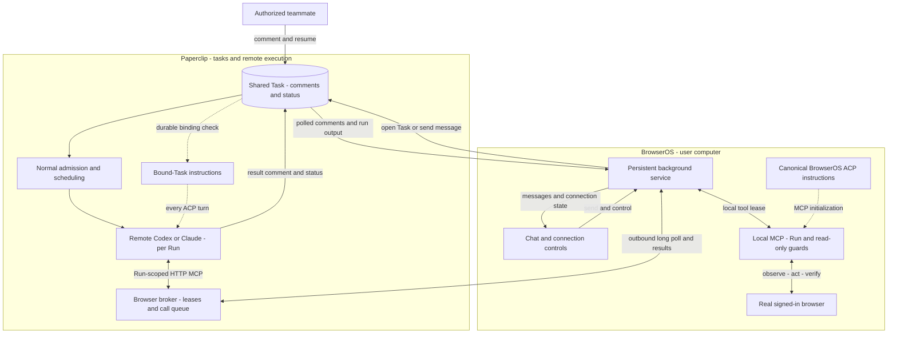

# Paperclip agents

This source build adds a native **Paperclip** agent alongside local Codex, Claude and custom ACP agents. In Settings → AI & Agents, choose **Add Paperclip**, enter the server origin, authorize your account, and select a remote agent. OAuth device authorization and refresh are handled by the local BrowserOS server. To reconnect an existing account, choose **Edit → Reconnect account** in its configured-agent menu; the local connection ID is retained so saved conversations keep their Tasks.

The Paperclip server needs the companion `/api/browseros` integration, authenticated accounts, `PAPERCLIP_PUBLIC_URL`, and **Assistant connections (MCP)** enabled. Remote origins require HTTPS; localhost HTTP is supported for development. The current server integration supports legacy `codex_local` and `claude_local` adapters, with Codex ACP live-tested. It does not expose a generic ACP HTTP transport and does not yet support Paperclip's native Runner.

Every conversation creates its own Task on first send. Its Task ID and exact mutation arguments are saved atomically under the BrowserOS data directory's `agents/paperclip-sessions/` folder. Follow-up messages continue that Task. A stable UI message ID retains the same request receipt after retries. Switching a saved conversation to a different remote connection is rejected; start a new conversation instead.

The agent executes in Paperclip. BrowserOS maintains an outbound authenticated long poll in its local background service, including after a turn completes or the chat window closes. Enabled connections restore from disk when the service restarts. Browser calls arrive through that connection and execute against the local MCP endpoint using the conversation's internal tool lease, window context and read-only flag. Tool results return to the agent; Task comments and run output synchronize into the local conversation. BrowserOS never exposes an inbound public tool endpoint. The connection bar exposes Pause remote control / Resume remote control and Stop task. Stop cancels current Paperclip runs while leaving the connection available for later messages; Pause revokes browser access while continuing message synchronization.

OAuth credentials are stored with the local server's agent configuration, omitted from public agent API responses, and refreshed using rotating refresh tokens. Browser calls are not automatically replayed after an ambiguous network outcome. Tasks survive reconnects; in-flight browser calls do not survive a server restart. The current Paperclip broker is process-local, so deployments need one API process or consistent connection routing. A browser must remain online while its tools are in use.

Text prompts are supported. Add attachments directly to the linked Task in Paperclip. Remote permissions, approvals, budgets and CLI credentials are configured in Paperclip. Local validation used an independent Paperclip process/database and the BrowserOS development browser; public cross-machine HTTPS and live Claude execution were not verified.

Focused checks:

```sh
bun run typecheck
bun test apps/server/tests/lib/agents/acp/paperclip-agent-runtime.test.ts apps/server/tests/api/routes/agents.test.ts apps/server/tests/api/services/mcp/browser-mcp-module.test.ts
```

Start a source development browser with `bun run dev:watch -- --new`. Its output reports the randomized browser CDP and local server ports; the installed production BrowserOS binary is not replaced by this source change.

## Model and reasoning effort

In **AI & Agents → Paperclip agent menu → Edit**, select **Model** and **Reasoning effort** and save. Editing these settings uses the existing connection without another OAuth approval. Model choices and model-specific effort choices come from Paperclip's adapter catalog. **Agent default** clears the corresponding task override. The configured agent row shows explicit selections.

Changed local settings apply to the next new message, including follow-ups on the same Task. When local settings have not changed, sends omit them so model overrides edited in Paperclip remain authoritative. Paperclip updates the Task's adapter overrides and comment together using its normal task update API; it does not change the remote agent's global configuration. BrowserOS persists the settings with the message receipt, so retrying a message retains its original configuration even after defaults are edited. Rejected or unconfirmed receipts terminate the stream with an error rather than waiting for a run that may never start.

## Team continuation and synchronization

Any teammate who can continue the Task through Paperclip's existing permissions may reply there and drive the attached browser. The connector account owns the device transport; it need not be the run's responsible user. Company, Task, active-run and read-only boundaries remain enforced. Only BrowserOS-created Tasks can attach a browser, and another client cannot take over a live attachment.

The local service is the single writer for the Paperclip transcript. It reconciles all comment pages approximately every two seconds, using server comment IDs and local mutation IDs to avoid echo loops and duplicate messages. Edits and soft deletions are reflected too. Agent Task comments replace transient run output when available. No synchronized comment is sent back as a new prompt. The frontend observes this state even when it has no active chat stream.

A remote tool call gets a short-lived local lease pinned to its exact remote Run. An authorization check precedes dispatch, and a watchdog cancels local work after remote revocation. Losing a poll or response never automatically repeats the action. A service restart restores the connection and transcript, not uncertain in-flight tool outcomes. Legacy saved bindings from before persistent connections become enabled on their next local message.

## Architecture at a glance

The Task is the shared record, the remote Agent owns reasoning and Task execution, and BrowserOS owns the local browser. The background service persists beyond an individual chat turn; Agent Runs are still admitted and scheduled normally. Solid edges show data/call flow and dotted edges show instruction delivery.



All browser transport requests originate from the user's computer. The bidirectional edge represents request/result flow, not an inbound public connection to BrowserOS. MCP initialization instructions follow the same local MCP → background service → broker → Agent return path.

The background service runs two independent loops: browser attachment/long-poll dispatch and full paginated comment reconciliation with incremental run output. The latter waits about two seconds between passes. Stable message/request IDs prevent echo loops; synchronized comments never resubmit themselves. Formal Task comments replace provisional output for the same Run.

| Event | Browser control | Transcript and recovery |
| --- | --- | --- |
| Turn completes or chat view closes | Background connection stays available | Synchronization continues |
| Pause remote control | Detach and abort local calls | Synchronization continues; resume before a new local send |
| Stop task | Cancel queued/running/retry Runs and revoke their access | Connection and synchronization remain for future messages |
| BrowserOS service disconnects | A lease can expire; old Run capabilities then fail | Reconnect and reconcile on recovery; never blindly replay uncertain actions |
| Paperclip process restarts | In-memory leases and pending calls are lost | Durable Tasks remain; BrowserOS attaches again |

Task-scoped collaboration/disconnection/result instructions are included in every ACP turn, including resumed and offline turns. Canonical BrowserOS operation instructions are delivered when the remote MCP initializes. These are ACP turn and MCP initialization instructions, not new provider-native system messages. Prompt scope and tool authority are separate: the durable binding selects the contract, while a live lease plus active Run authorizes browser execution.


Team verification on the independent local instance exercised a different operator account, browser tab creation after foreground completion, both transcripts, paused control with continuing message sync, task cancellation, and restored connections. Production/browser binary installation is separate from these source changes.


## Remote agent instructions

For a Paperclip remote-run tool lease, MCP initialization includes the same `BROWSEROS_ACP_INSTRUCTIONS` used by local ACP, followed by the live MCP operating instructions. The string remains owned by `apps/server/src/lib/agents/acp/browseros-instructions.ts`; only the Paperclip lease path adds it, so ordinary MCP clients are unchanged.

The companion Paperclip server also injects a BrowserOS-bound Task contract into every Codex/Claude ACP turn, including resumed turns and turns without a live browser. It covers browser-only tool routing, fresh observation and verification, team continuation, disconnect/pause/Stop handling, uncertain effects and writing results to the shared Task. Its scope comes from the durable company/Task creation receipt, not the Task description. Existing bound Tasks pick it up on their next run; ordinary Tasks and global Agent configuration are unaffected.

This is a combination of ACP turn instructions and MCP initialization instructions, not a new provider-native system message. When browser access is missing, the Agent should record the blocker and required recovery in the Task, continue only independent work, and avoid alternate browsers or blind replay. A pause retains transcript synchronization. Final results are posted to the Task once and synchronize back automatically.

Message synchronization negotiates `messageSyncVersion: 1` with Paperclip. New servers return incremental comment updates and deletion markers; the background connection saves the cursor with its local cache after the conversation is stored. Paused connections keep synchronizing, and restarts reuse the same Task and saved cursor. Older servers retain full pagination. Redaction/projection changes and periodic reconciliation rebuild the cache; execution snapshots and ACP output still use the existing polling path.

本轮增量同步与真实远程执行的完整验证记录位于配套 Paperclip 仓库 `tests/browseros-machine-acceptance/incremental-sync-validation-2026-10-19.md`。
